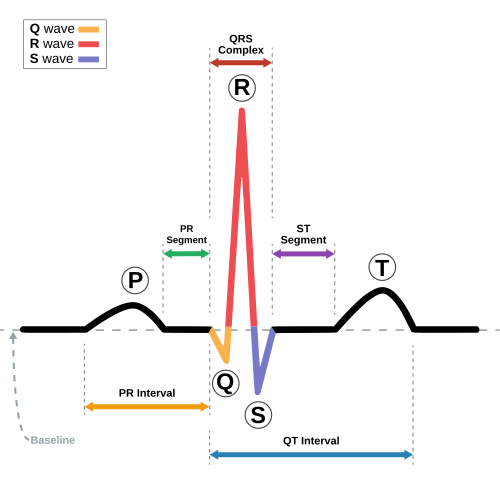
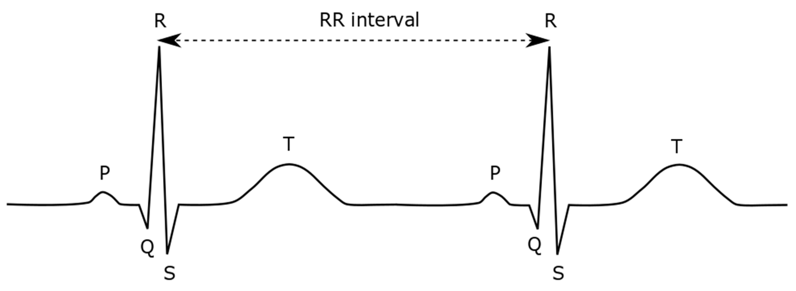
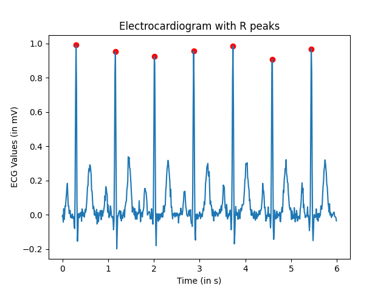

📝 **Worth:** 7 % 


## 🎯 Learning Objectives

- Create a list to store multiple values

- Plot lists using `matplotlib`

- Read data from a *Comma Separated Values* (.csv) file 

- Develop an algorithm to detect peaks

  

## Context: Heart Beats ❤️

As the heart pumps blood through the body, it emits an electric signal which can be measured, amplified  and displayed. This is what we call an *electrocardiogram*, each heart beat is characterized by a the cardiac cycle made up of different waves named *P wave, QRS complex* and the *T wave* as shown below. They offer various medical insights on the patient's health. 




# Part 1: Plotting the ECG

**🗓️ Due:** As per Lea.

📥 **Submission: ** 

- [ ] ECG graph **demoed to teacher in class.**
- [ ] Code submitted on  [Gradescope](https://www.gradescope.ca/courses/39225) 
  - [ ] `my_functions.py`
  - [ ] `part1.py`
  - [ ] `part1_ecg.png`


## **📝  Specific Instructions** 

The structure of this assignment will be different than the Assignment2: 

- [Download](part1.zip){target="_blank"} and extract the starter code.

- You will be working within **two python files**:

  - `my_functions.py` : Where all the functions should be defined 

  - `part1.py`: This is where the `main()` function is calling the other functions 

- Keep both files in the **same folder**

- I added an `import` statement in `part1.py`, **please DO NOT remove this line**

  ```python
  from my_functions import *
  ```

  - the `*` means import all the functions defined in this file.

- As usual, **do not rename the files, respect each function name and its parameter list**

- Make sure **Matplotlib** is installed, if not follow [these instructions](https://john-abbott-college.github.io/SN1-Notes/topics/12_data_processing/02_installing_modules/02_installing_modules.html){target="_blank"}


## Task

In `part1.py`, you are given a sample `ecg` containing 500 heart signals measured in milivolts (mV). The sampling rate is 360 Hz, which means 360 samples were measured every second. The goal is to plot the ecg_values over time_values and save this figure. 

** In `my_functions.py`, write the following functions** : 

#### Write a function `create_time_axis()`

**Input parameters: **

`ecg_values`:  A list of floats representing the ecg values (in mV)

`sampling_rate`: A float representing the rate at which the samples were measured (in Hz)

**Return: ** 

A list of time values in seconds 

- It should have the same length as the `ecg_values` list. 
- It should start at `0`seconds. 

- Increase by a constant time interval of `1 / sampling_rate` seconds between consecutive values.
- Maintain the same order as the original ECG measurements, ensuring that each time value corresponds to its respective ECG sample.

>  **For example**,  suppose  `sampling_rate = 360` and `ecg_values` contains 500 measurements.
>
>  Since 360 samples are recorded every second, the time interval between consecutive samples is:
>
>  $\Delta t = \frac{1}{360} \approx 0.00278 \text{ seconds}$
>
>  The resulting time values should be : $[0, \frac{1}{360}, \frac{2}{360}, \frac{3}{360}, ..., \frac{i}{360}, ... , \frac{499}{360}]$


#### **Test**

Call the function in `main()` in the `part1.py`:

```python
def main():
  ecg = [-0.955, -0.91, -0.895,...]
  time_values = create_time_values(ecg_values=ecg, sampling_rate=SAMPLING_RATE)
  print(time_values)
  print(len(time_values))
```

**Expected output**:

```cmd
[0, 0.002777777777777778, 0.005555555555555556, 0.008333333333333333, ...]
500
```


#### Write a function `plot_ecg()`

**Input parameters:**

- `ecg_values` : list of floats of ecg readings 
- `time_values`: list of floats of the seconds 
- `output_filename`: the filename under which the graph image will be saved.
- `show_graph`: A boolean, when set to `True` the figure should be shown on the screen, otherwise, it should not be shown.

**Return:** No return

**Task:**

- Plot the `ecg_values` versus the `time_values` 

- Apply appropriate styling using Matplotlib:

  - Add a title using `plt.title()`
  - Add an x axis title using `plt.xlabel()`
  - Add a y axis title using `plt.ylabel()`
  - Add a grid using `plt.grid(True)`

- Save the graph under `output_filename `using `plt.savefig()`

- If the boolean `show_graph` is `True`, display the figure with `plt.show()`

- Close the figure with `plt.close()`


#### Test

Call the function in the `main()` in the `part1.py`:

```python
def main():
  
  # previous lines...
  
  plot_ecg(ecg, time_values, "part1_ecg.png", True)

```


- Show your graph to your teacher

- Submit your code and your graph on Gradescope.


# Part 2: Detecting R peaks

**🗓️ Due:** As per Lea (different for each section)

📥 **Submission:** 

- [ ] ECG graph of the entire sample **demoed to teacher in class.**
- [ ] Code submitted on  [Gradescope](https://www.gradescope.ca/courses/39225) 
  - [ ] `my_functions.py`
  - [ ] `part2.py`
  - [ ] `part2_ecg.png`
  - [ ] `part2_ecg_with_peaks.png`

### **📝  Specific Instructions** 

- [Download](part2.zip){target="_blank"} and extract the starter code.

- Extract the ZIP folder for Part 2.

- Make sure you have the following files **in the same folder**:

  - `part2.py`: This is the main program you will work on for Part 2.
  - `my_functions.py`: Continue using the same file you created in Part 1.
  - `ecg.csv`: The dataset containing the ECG samples. This is synthetic data generated with the help of an AI tool.
  - `part1.py`: Keep this file for reference. **You will not need to modify it.**

  

- In `part2.y` , you are given functions to read the `ecg.csv`, feel free to look at those to better understand how a program can load data from a file.

<span style="color:red"><strong>DO NOT REMOVE THOSE LINES</strong></span>

```python
import csv 
from my_functions import *
SAMPLING_RATE:float = 100
FILENAME:str  = 'ecg.csv'


def convert_to_floats(row:list[str])-> list[float]:
  # some lines of code...

def read_data(csv_filename:str)->list[float]:
  # some lines of code...


def main():
    ecg_values = read_data(FILENAME)

    # TODO: Your code starts here


    
```

  


<span style="color:red"><strong>DO NOT MODIFY THOSE LINES, AND DON'T ADD ANY CODE AFTER</strong></span>

```python
if __name__ =='__main__':
    main()
```

  

  

## Your Task

In this final part of the assignment, we will focus on calculating the **heart rate** which is obtained by calculating the number of R peaks that occur per minute. 



Alternatively, if the **average** time interval (in s) between two R peaks is obtained $\overline{RR_{interval}}$, the heart rate in beats per minute can be calculated using the sampling rate $f_s$ in Hz (samples per second). 
$$
hr= \frac{60}{\overline{RR_{interval}}}
$$


Implement an algorithm to scan the ECG signal and identify the indices of the R peaks. You can safely assume that **high-amplitude impulses** in the signal correspond to R peaks.

Here are functions to help you accomplish that: 

#### Write a function `is_local_maximum()`

**Input parameters:**

- `ecg_values`: list of readings
- `test_index`: index of a reading that could be a local maximum

**Returns: **

- `True`: if it's a local maximum (it's value being larger than the previous value and the next value)
- `False`: if this reading is not a local maximum

**Warning and things to consider:**

- Are there any constraints on `i` to avoid getting an index out of range error?

- Return `False` if `i` might cause an index out of range. 

  


#### Write a function `find_r_peaks()`

**Input parameters:**

- `ecg_values`: list of ecg signal values.
- `time_values`: list of time values in seconds 
- `threshold_ratio`: A float from `0` to `1` representing the minimum threshold of an R peak relative to the global maximum value of the ecg signal. It's set to `0.5` **by default**, but should be finetuned experimentally.
- `min_timelapse`: A float representing the minimum timelapse between 2 R peaks. Is set to `0.0833` seconds **by default**, but should be finetuned experimentally. 

**Returns:**

- `peaks`: list of **indices** corresponding to the detected R peaks in the signal. (**Indices NOT values!** )

**Guidelines to build the algorithm**

1. An R peak is a local maximum.
2. You can safely assume that high amplitude peaks above or equal to `threshold*maximum` where `maximum` is the global max of the signal are R peaks
3. There cannot be two consecutive R peaks within `min_timelapse` (two R peaks cannot be too close to eachother).

**Warning and things to keep in mind**

- Which indices can you safely pass to `is_local_maximum()`? 
- To check condition 3, what do you need to remember as you go through the signal? What should it be when no peak has been found yet?


#### Write a function `plot_ecg_peaks()`

**Input parameters**

- `ecg_values`: list of ecg readings of a given patient
- `peaks`: list of indices of the R peaks
- `sampling_rate`: the number of samples taken per second (in Hz)
- `filename`: the filename under which the graph image will be saved.

**Task**

You must plot the ECG signal versus time and highlight the detected peaks using a different marker (e.g., red dots). Apply appropriate styling using Matplotlib.

#### **Testing**

Call the functions in the `part2.py` file inside the  `main()` function and visually ensure that the algorithm correctly identifies all the R peaks for the signal assigned to you. Save the figure with the peaks.

```python
def main():
  ecg = read_data(FILENAME)
  time = create_time_values(ecg, SAMPLING_RATE)

  
  # some more lines
  r_peaks = find_r_peaks(ecg, time, 0.5, 0.0833)
  plot_ecg_peaks(ecg, time, r_peaks, f'part2_ecg_with_peaks.png', False)
	
```

- Feel free to change the `threshold_ratio` and `min_timelapse` parameters to observe their effect on the algorithm.



### Write a function `heart_rate()`

**Input parameters:**

- `peaks`: list of indices of the R peaks
- `sampling_rate`: the number of samples taken per second (in Hz)

**Returns:**

- The heart rate in beats per minute.

**Algorithm:**

- For every peak,

  - Calculate its distance from the previous peak in sample count

  - find the time interval between these two peaks:

    $RR_{interval} = \frac{R_i - R_{i-1}}{f_s}$

  - Accumulate all the $RR_{interval}$s  to get the average 

  

#### Test

Call this function in `main()` provided the r peak indices found earlier and the sampling rate. Print the calculated hear rate. You should obtain roughy 70 beats per minute. 

