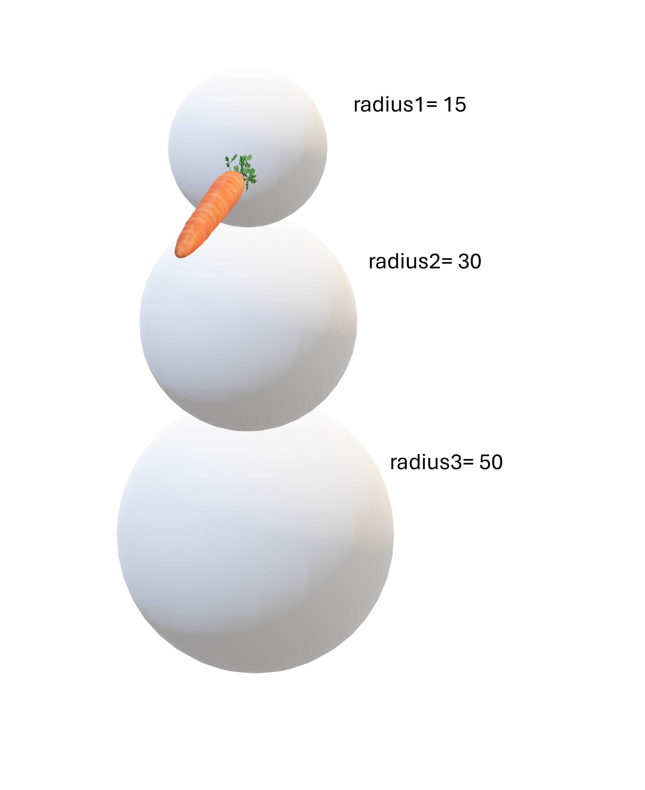
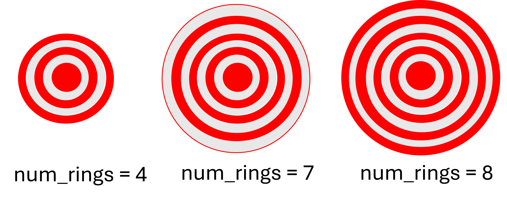

::: {.callout-warning .objectives icon="false" title="☆ Learning Objectives "}
- **Read** a word problem and translating it into solvable steps
- **Divide** down complicated code into re-usable functions
- **Identify** when a problem requires a loop.
:::

In this course, teachers will throw at you very wordy problems that can seem scary. But they always have "patterns" that can be translated to code. In this series of problems, we'll explore how to use functions effectively to breakdown a problem into smaller solvable steps. 

# Problem 1: Snowman ☃️
You are building a snowman, your landlord (being a bit grumpy) is complaining that your snowman is going to weigh too much and damage his front lawn. 


So, to calculate the weight of the snowman, you must first calculate the weight of snow for a given size of individual ball of snow, then add up all the snow balls weights together. The density of snow is  $\rho = 0.30$.




Write a python program which calculates the snowball weight while avoiding repeated calculations. The weight of each ball can be calculated using the following fomula:


$$
w =  \frac{4}{3} \rho \pi r^3
$$

> You can use `math.pi`:

::: {.callout-hint}
::: {.callout-note title="Hint2" collapse="true"}
- The volume of each ball will be repeated for each ball (3 times)
- It's worth creating a function to perform the calculation and return the volume!
:::
:::

:::{.callout-tip title="Possible Solution" collapse="true"}
```{python}
import math

def snow_weight(density, radius):
  return (4/3)*density*math.pi*(radius**3)

def main(): #This is completely up to you, but I prefer putting the main program code in a `main()` function.
    radius1 = 15
    radius2 = 30
    radius3 = 50
    density = 0.30


    ball_1 = snow_weight(density, radius1)
    ball_2 = snow_weight(density, radius2)
    ball_3 = snow_weight(density, radius3)

    total_weight = ball_1 + ball_2 + ball_3

    print(total_weight)

```
:::

# Problem 2: Bacteria 🧫

A scientist is studying the growth rate of a bacteria colony. The colony starts with an initial population of 500 bacteria. Each year, the population increases by 100% except on the last year, the population grows by 150%. These values might change for various kinds of bacteria. 

- Write a program to simulate the growth of the colony over a given number of years `num_years` and print the increase in bacteria and the expected total population **every year**.

- Run a simulation for `num_years=10` with the provided growth rates mentioned above.

:::{.callout-tip title="Possible Solution" collapse="true"}
- This problem is simple enough to solve without any functions! 

- But for the sake or practice, let's use functions!

- One calculation that's important is finding out how many new bacteria are created each year.

 - For that we can use a function! Let's call it `get_increase()`! 


```{python}
def get_increase(population, increase_percent):
    return population * increase_percent

def bacteria_simulation(start_population, num_years, normal_growth, final_growth):
    """
    Runs a simulation of bacteria growing every each by a given rate in decimal (from 0 to 1)
    except for the final year where the bacteria grow at a different rate. Displays each year and 
    the expected population at that year. 

    Args:
        - start_population : Starting population of bacteria in count of bacteria (ex: 500)
        - num_years: Number of years to simulation the bacteria growth for.
        - normal_growth: rate in decimal (from 0 to 1) of new bacteria created every year
        - final_growth: rate in decimal (from 0 to 1) of new bacteria created on the last year
    """
    population = start_population
    increase = 0
    for year in range(1, num_years+1):
        print(f"Year: {year} Population: {population} Increase: {increase}")

            
        if year == num_years:  #last year
            increase = get_increase(population, final_growth)
        else:
            increase = get_increase(population, normal_growth)
        
        population += increase

bacteria_simulation(500, 10, 1, 1.5)
```
:::

# Problem 3: Targets 🎯

A company designs archery targets of different sizes. The targets are coloured in red and white paint as shown in the figure below:


They are currently offering a wide selection of sizes characterized by the number of red and white rings (`num_rings`) as shown in the figures below. 

All target have a red central circle with a `radius` = 5 cm. All rings have the same `thickness`= 3cm:




The company has tasked you with creating a script which calculates the area they must cover with red paint provided with the number of rings (`num_rings`). 

::: {.callout-hint}
::: {.callout-note title="Hint" collapse="true"}
Start with solving `num_rings`= 4 by hand, then try `num_rings = 5`, then try for `num_rings=6`. Is there a common pattern?
:::
:::

::: {.callout-hint}
::: {.callout-note title="Hint2" collapse="true"}
No mattern `num_rings`, the middle red circle is the same. The red rings are defined by an outer and inner circle:

$$ A_{ring} = A_{outer} - A_{inner} $$

- This calculation comes back often, maybe a function could take care of doing this?
:::
:::

::: {.callout-hint}
::: {.callout-note title="Hint3" collapse="true"}
Now, you might start to realize that even with a area calculating function, the number of times a red ring appears isn't fixed, it depends on `num_rings`:
- if `num_rings` is even, there's an even number of red rings
- if `num_rings` is odd there's an odd number of red rings. 

How can you "visit" all the possible radii while skipping the white ones?
:::
:::

::: {.callout-hint}
::: {.callout-note title="Hint2" collapse="true"}
Answer to previous hint: A loop which skips every 2 `i`s or a condition with `if i % 2 == 0`! 

The total area, will require an accumulated variables `total`
:::
:::

:::{.callout-tip title="Possible Solution" collapse="true"}

- I broke down every calculation step into small calculating functions 
- I also made a bigger function `red_area()` that takes `num_rings` as parameter and takes care of the loop.
- This function will also handle the even/odd numbers of rings to make for sure we visit an exact count of red rings
- The pattern identified is that between every consecutive red ring, there's a distance of exactly `2*thickness`
```{python}
def area_circle(radius:float) -> float:
    return (radius**2)*math.pi

def area_rings(inner_radius:float, outer_radius:float)->float:
    area_outer = math.pi * (outer_radius**2)
    area_inner = math.pi * (inner_radius**2)
    return area_outer - area_inner

def red_area(num_rings:int)->float:
    # Variables that seemed fixed no matter the number of rings
    radius = 5
    thick = 3
    
    total = area_circle(radius) # central circle
    
    num_iterations= num_rings
    if num_rings%2 == 1: #even
        num_iterations = num_rings-1
    for i in range(1, num_iterations, 2): #skip the white rings
        inner_r = radius + thick * i
        outer_r = inner_r + thick

        total += area_rings(inner_r, outer_r)

    return total
```
:::

:::{.callout-tip title="Possible Solution" collapse="true"}
- In this solution, the focus is on **circles** rather than rings. 
- The idea is to visit all circle radii:
    - if the radii corresponds to a red circle: we can **add (+) area** 
    - otherwise, if it's a white circle: **subtract (-) area**

```{python}
def area_circle(radius:float) -> float:
    return (radius**2)*math.pi

def red_area(num_rings):
    radius = 5 #start with the central red circle.
    thickness = 3
    num_iterations = num_rings

    total = 0
    if num_rings%2 == 0:
        num_iterations+=1
    for  i in range(num_iterations):
        if i % 2 == 0: # Red
            total += area_circle(radius)
        else:          # White
            total -= area_circle(radius)
        radius += thickness
    return total
```
:::


# Problem 4: The Taxi Driver 🚕

Bob has just started driving a taxi in the city and wants a small program to help keep track of a day on the road. Bob has noticed that the same few calculations come up again and again and he'd like to automate them.

Here is what Bob knows about the job:

- Passengers are charged a base fare of **$3.00 for every kilometer** they travel.
- His car can travel **10 L per 100 Kmr** of fuel (0.1 L/Km)
- The fuel tank holds **50.0 L**, and he starts the day with a **full tank**.
- He starts the day with **$0.00** in earnings and has driven **0 km**.
- Fuel costs **$2.00 per litre**, and the cost of fuel is taken out of his earnings.

Bob is a careful driver and never wants the tank to get too low. Whenever the fuel level drops **below 85%** of his tank, he stops at a gas station **between trips** and wants to see a message `Refuelling car`, he then proceeds to fill the tank back up to 50.0 L.

Here are the trips planned for today:

- 100 Km at the base fare
- 50 Km at the airport with a $2.00 extra + base fare
- 120 Km outside the city so his car can go up to 7L/100Km (0.07 L/Km)

### Expected output:

For every trip:

- Display the Km travelled 
- The earnings made
- The fuel it burnt and its expected cost
- The net income $ Net = Earning - Cost $
- Check for refuelling 
- Print a message when refulling 


::: {.callout-hint}
::: {.callout-note title="Hint 1" collapse="true"}
    - What is known in this problem (which values are fixed or given)? → create variables for those.
    - What calculation/operation repeats itself? → These might become your functions.
    - What values are constants of the problem? → These could be "CONSTANTS" shared by all the functions.
:::
:::


::: {.callout-hint}
::: {.callout-note title="Hint 2" collapse="true"}
    - Try breaking down the provided instructions into sequential steps: 
     - 1. Define variables...
     - 2. Update the variables after the first trip...
     - 3. Calculate earnings, cost and net income
     - 4. Check if needs refuelling, if yes refuel tank and update costs.
     - 5. Repeat for the second trip...

    - If you've identified a calculation that **clearly** comes back often, or steps that **clearly** come back often. That likely should be a function! 

:::

:::


:::{.callout-tip title="Possible Solution" collapse="true"}
- **How I broke the problem down:**
  - First, I listed the **constants**: values that never change during the day (at least as the problem describes them).
  - Next, I listed the values that change from trip to trip and need tracking. These became **variables**.
  - Then I looked for calculations that happen on every trip. These became **functions**:
    - earnings, from the distance, the fare and any bonus
    - fuel used, from the distance and the car's fuel consumption
    - fuel cost, from the amount of fuel used

- **Spotting more repetition:**
  - While writing the main program, I noticed whole groups of lines were repeated for each trip, so I moved them into two more functions: `get_refill()` and `go_trip()`.
  - These two are a bit unusual: they both print *and* return values, so they don't have one crystal-clear job. They exist mainly to avoid copy-pasting the same code.

- **The main program:**
  - `main()` now only holds what's specific to each trip (distance, bonus, fuel consumption).
  - There's still some repetition, but I chose to keep it in the main. Hiding more lines inside functions would make `main()` harder to follow, and is not necessarily the correct design for this problem. 
  - Instead, the program could be improved with lists of trips with a main loop handling those repeated steps. 

- **Next step:**
  - Store all the trips in a list and loop over it. That's a topic for later!
  - This program is a work in progres...


```{python}
# Constants 
TANK_CAPACITY:float = 50.0        # in L
REFUEL_LIMIT:float = 0.85          # in %
FUEL_COST:float = 2.00            # in $/L
BASE_PRICE: float = 3.00          # in $/Km
NORMAL_CONSUMPTION: float = 0.1   # in L/Km
    
def trip_earnings(distance: float, fare:float=BASE_PRICE, bonus:float=0.0) -> float :
    """
    Calculates the earnings of a trip given the travelled distance
    for that trip, the fare in $/Km and the bonus in $ for every km. 
    """
    return distance * (fare + bonus)

def fuel_usage(distance:float, consumption:float = NORMAL_CONSUMPTION) -> float :
    """
    Calculates the fuel consumption in L for a trip.
    Args:
     - distance: Trip travel distance in Km
     - consumption: Fuel consumption in L/Km
    Returns:
     - used lit
    """

    return distance * consumption

def fuel_cost(liters:float, gas_price:float=FUEL_COST) ->float:
    """
    Calculates the fuel cost
    Args:
        - liters : The total liters of fuel
        - gas_price: The cost of fuel in $/L

    Returns: total cost of fuel in $
    """
    
    return gas_price * liters

def get_refill(current_tank:float, max_capacity:float=TANK_CAPACITY, limit_percent:float = REFUEL_LIMIT) ->float:
    """
    Checks if the fuel tank is below a limit, if it's the case
    returns the refill amount required. Otherwise the tank doesn't need refill
    it'll return 0. 
    Args: 
     - current_tank: current level of fuel in the tank
     - max_capacity: tank maximum capacity 
     - limit_percent: percentage of the tank underwhich the car is refuelled. 
    Return:
    - fuel refill amount if refilling required 
    """
    refill = 0
    if current_tank  <= limit_percent*max_capacity:
        print("Refuelling car...")
        refill = max_capacity - current_tank
    
    return refill

def go_trip(trip_distance:float, bonus_fare:float=0.0, consumption:float=NORMAL_CONSUMPTION)->(float,float,float):
    """
    Function performing all calculations done in a single trip to get earning, costs and fuel usage and displays them. 
    Args:
     - trip_distance: distance in Km for the given trip
     - bonus_fare: bonus amount in $/Km for the given trip
     - consumption: fuel consumption rate in Km/L for that trip 
    
    Returns: 
     - trip_earning 
     - fuel_used
     - trip_cost
    """

    trip_earning = trip_earnings(distance=trip_distance,bonus= bonus_fare)
    fuel_used = fuel_usage(trip_distance, consumption)
    trip_cost = fuel_cost(liters=fuel_used)
    
    # output for 1st trip
    print(f"Distance travelled: {trip_distance} Km")
    print(f"Trip Earnings: $ {trip_earning:.2f}")
    print(f"Fuel Used : {fuel_used} L")
    print(f"Trip Cost: $ {trip_cost:.2f}")
    print(f"Trip Net profit: ${(trip_earning -trip_cost):.2f}")
    
    return trip_earning, trip_cost, fuel_used
    
def main():
 
    # Variables 
    earnings:float = 0.0           # in $
    costs: float = 0.0             # in $
    fuel_level:float = 50.0        # in L
    
    # First trip info
    print()
    print("Trip 1")
    trip_earning, trip_cost, used = go_trip(trip_distance=100)    

    # updating global earnings, costs and fuel level
    earnings += trip_earning
    costs += trip_cost
    fuel_level -= used 

    #checking if refuelling needed
    fuel_level +=  get_refill(fuel_level)


    # Second trip info
    print()
    print("Trip 2")
    trip_earning, trip_cost, used = go_trip(trip_distance=50, bonus_fare=2.00)

    
    # updating global earnings, costs and fuel level
    earnings += trip_earning
    costs += trip_cost
    fuel_level -= used 

    #checking if refuelling needed
    fuel_level +=  get_refill(fuel_level)
    
    
    
    # Third trip info
    print()
    print("Trip 3")
    trip_earning, trip_cost, used = go_trip(trip_distance=120, consumption=0.07)

    
    # updating global earnings, costs and fuel level
    earnings += trip_earning
    costs += trip_cost
    fuel_level -= used 

    #checking if refuelling needed
    fuel_level +=  get_refill(fuel_level)

    

    print("Day summary")
    print(f"Total earnings: $ {earnings:.2f}")
    print(f"Total costs: $ {costs:.2f}")
    print(f"Tank level: {fuel_level} L")

    

    

main()


```

:::