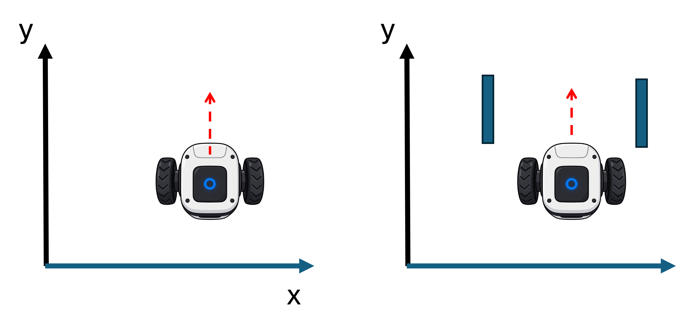
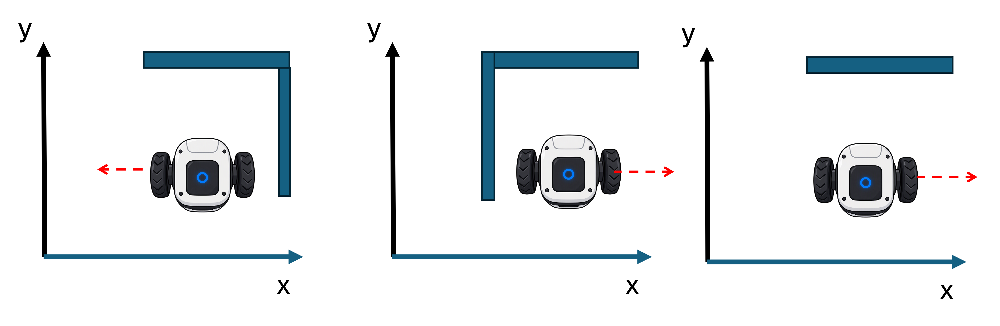
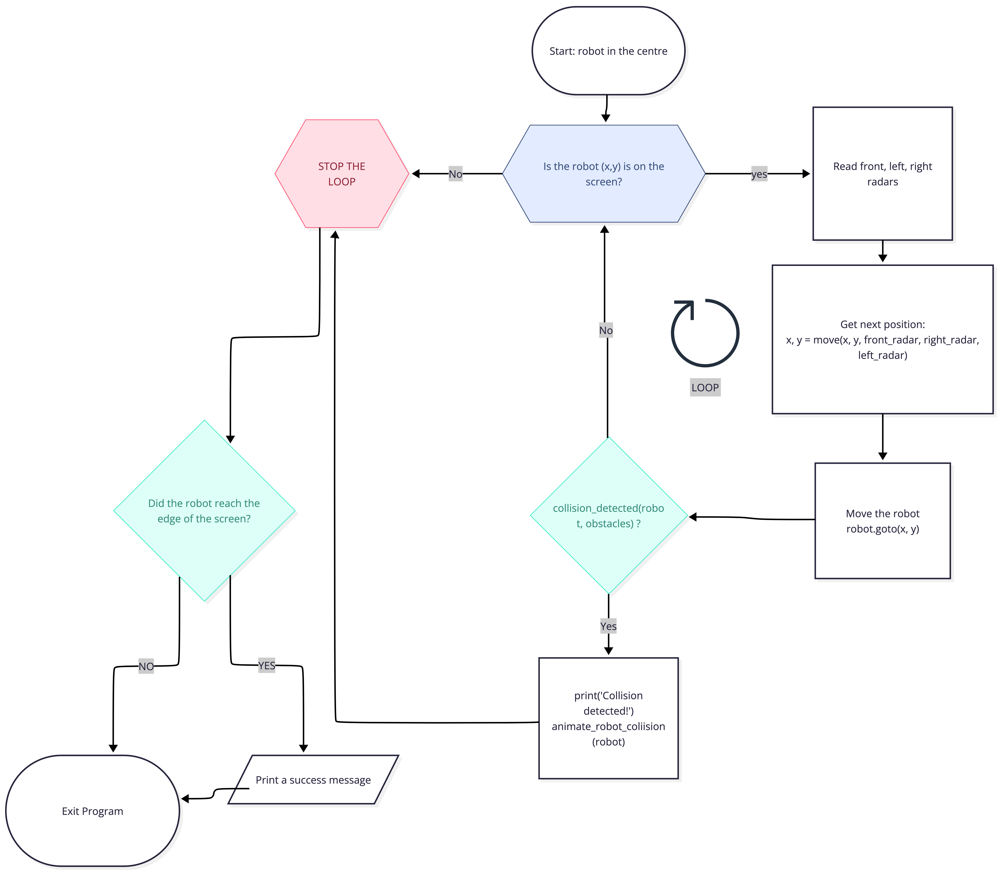
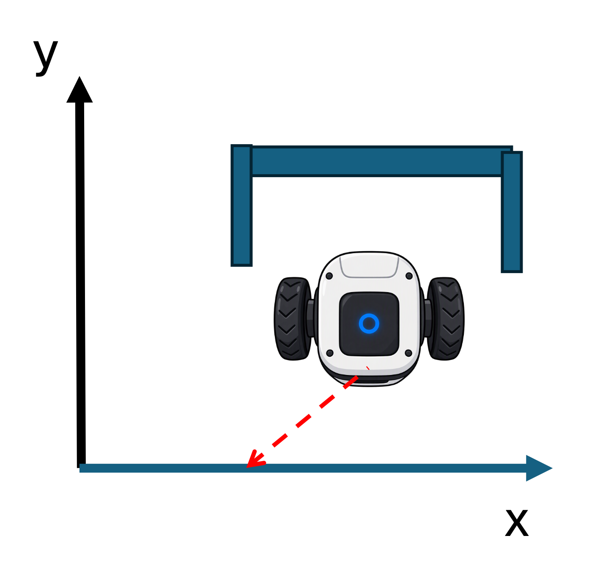
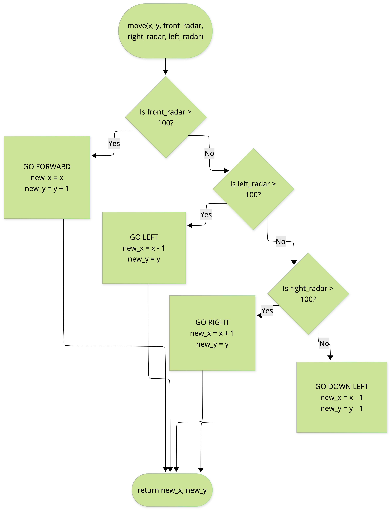

📝 **Worth:** 1 % 

📥 **Submission - By the end of class**:  upload your `.py` files on [Gradescope](https://www.gradescope.ca/courses/39225)

**📝 General Instructions:**

- Download the starter code [here](unzip_me.zip){target="_blank"}

- ⚠️ **EXTRACT THE ZIPPED FOLDER**: 💀💀 working in a zipped folder is BAD!💀💀

- ✅ **Collaboration** is encouraged, **submit your own independant work**

  

## 🎯 Learning Objectives

In this lab you will program a robot to drive out of a room full of obstacles without hitting any of them. The robot has three radar sensors (front, left, right) and you decide how it moves based on what they read.

By the end of the lab you should be able to:

- Read sensor values and use them in `if / elif / else` decisions
- Use a `while` loop to repeat steps until a condition is no longer true, and `break` to leave it early
- Trace how a program's loop updates position step by step
- Build a simple decision algorithm step by step and test it on different random layouts

## 📝  Specific Instructions 

Ensure that these three files are in the same folder:

| File | What it is | Do you edit it? |
| --- | --- | --- |
| `collision_avoidance.py` | Your main program | Yes |
| `collision_helper.py` | Radar, obstacles and collision checks | No |
| `robot_shape.gif` | The robot picture | No |

Run the program with `python collision_avoidance.py`. A window opens with brown obstacles and the robot in the centre. The terminal prints the three radar readings at every step.

## How the starter code works

Right now `main()` reads the radars once, calls `move()` once and checks for a collision once. The robot makes a step up by 1 pixel and stops moving on the screen. 

When you finish, `main()` should repeat these steps until the robot **leaves the screen or crashes**:

1. Read the three radars with `read_radar(robot, obstacles, direction)`.
2. Call `move(x, y, front_radar, left_radar, right_radar)` to get the **next position.**
3. Move the robot there with `robot.goto(x, y)`.
4. Stop if `collision_detected(robot, obstacles)` is `True`.

**What the radar tells you:**

- Each reading is the **distance** (in pixels) to the nearest obstacle in that direction.

- If nothing is in that direction, the reading is `1000` (`RADAR_INFINITY`).

- **"forward"** always means up the screen $+y$:  

  

- **"left"** means $−x$ and **"right"** means $+x$ and.The robot never turns; it only slides:

  

The starter `move()` always moves the robot up one pixel, whatever the radars say. You will fix that in Part B.

## Your tasks

Work through these in order. Only edit `collision_avoidance.py`.

### Part A: finish main()

#### TODO 1: Repeat until condition

Repeat the following steps while the robot's position meets this condition $X_{MIN} < x < X_{MAX}$  **and**  $Y_{MIN} < y < Y_{MAX}$

- reading radars
- invoking `move()`
- moving the robot with  `robot.goto()` 
- checking for collisions  

#### TODO 2: Stop on crash

Inside the collision `if`, interrupt the loop.

:::{.callout-tip icon="false" title="Main flowchart" collapse="true"}

:::

#### RESULT:

The robot drives straight up, collides into an obstacle and prints "Collision detected"!

### Part B: improve move()

#### TODO 1: No obstacle in front

The robot goes forward (`+1` along y, no change along x) 

>  

#### TODO 2: Obstacle in front  

The robot should check its left/right radars and move sideways and away from the obstacle (take a step `+1` or `-1` along the x and not move along y)

- It should prioritize a movement **right** in case there are no obstacles to either sides. 

> Here's a representation of three possibilities to go left/right:
>
> 

#### TODO 3: Obstacles in front and on the sides ("Boxed in")

The robot should take a step back (`-1` along y) and while turning left ( `-1` along x):

>  Here's a representation of what happens if the robot is "boxed in":
>
>  

:::{.callout-tip icon="false" title="Move flowchart" collapse="true"}

:::

#### RESULT:

The robot should now be avoiding obstacles and reaches the edge of the screen successfully!

## Demo

You will demo your program in class. Before your demo, check:

- [ ] The program runs with no errors
- [ ] `main()` loops until the robot leaves the screen or crashes
- [ ] A collision stops the loop and plays the blink animation
- [ ] The success message prints only when the robot reaches an edge
- [ ] `move()` checks front, then right, then left, and backs off down-left when all are blocked

During the demo, be ready to:

- Run your program at least once and explain what the robot does
