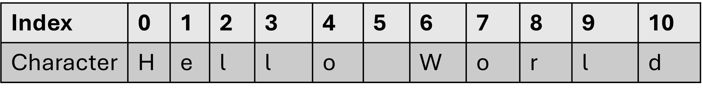
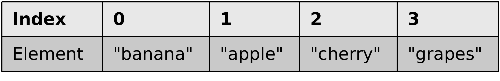

::: {.callout-note .objectives icon="false" title="☆ Learning Objectives "}
- **Access** an element of a list using its position (index).
- **Use** negative indexing to access elements from the end of a list.
:::

# What's an index?

Every item in a list has a position number called an **index**. Just like the chapters of a book: 1,2,3,4... 

Python starts counting at 0, not 1, so the first item is at **index 0**, the second is at **index 1**, and so on. That means the last item's index is always **one less than the length of the list**.

This is exactly like strings!


**Strings**
```python
message = "Hello World"
```
{height=100}

**Lists**

```python
fruits = ["banana", "apple", "cherry", "grapes"]

```

{height=100}


# Accessing element by index

Each of the list's elements may be accessed separately using `[]` and the **index**. 

:::{.callout-note icon="false" title="BASIC SYNTAX"}
```
element = my_list[index]
```
- the `my_list` is a non-empty list
- the `index` is an integer from `0` to `len(my_list) -`
- `element` is a new variable which hold the value at the given index.

:::

For example, it can be printed:

```{python}
numbers = [4,6,2]
print(numbers[0]) # Accessing the list's first element.
```

To print the whole list


```{python}
numbers = [4,6,2]
print(numbers[1]) # Accessing the list's second element.
```


```{python}
numbers = [4,6,2]
print(numbers[2]) # Accessing the list's third element.
```

:::{.callout-important title="Index out of range"}
Using the `[]`  accessor can be risky! If provided with an index outside the length of the list, the program will crash!
Try running this code!

```pyodide
numbers = [4,6,2]
print(numbers[3])
```
:::

## Negative indices are legal

It may look strange, but negative indices are legal, and can be very useful.

An element with an index equal to -1 is **the last one in the list**.

**Example:**

```{python}
numbers = [10, 5, 7, 2, 1]
print(numbers[-1]) # the output is: 1
print(numbers[-2]) # the output is: 2

```

So, the last accessible element in our list is numbers[-4] (the first one) ‒ don't try to go any further!

# Modifying elements

How do you change the value of a chosen element in the list?

Let's **assign a new value of 111 to the first element** in the list:

```{python}
numbers = [10, 5, 7, 2, 1]
print("Original list contents:", numbers)  # Printing original list contents.

numbers[0] = 111
print("New list contents: ", numbers)  # Current list contents.
```

And now we want **the value of the fifth element to be copied to the second element**:

```{python}
numbers = [10, 5, 7, 2, 1]
print("Original list contents:", numbers)  # Original list contents:[10, 5, 7, 2, 1]

numbers[1] = numbers[4]  # Copying value of the fifth element to the second.
print("New list contents:", numbers)  #New list contents: [10, 1, 7, 2, 1]

```

The value inside the brackets which selects one element of the list is called an **index**, while the operation of selecting an element from the list is known as **indexing**.

